<p align="center"></p>

<p align="center">
  <a href="https://github.com/behzodhalil/yawl/actions/workflows/ci.yml"></a>
  <a href="LICENSE"></a>
  <a href="go.mod"></a>
</p>

<p align="center">
  <a href="https://useyawl.com">Website</a> ·
  <a href="https://useyawl.com/docs/">Docs</a> ·
  <a href="#get-started">Install</a> ·
  <a href="SECURITY.md">Security</a> ·
  <a href="CONTRIBUTING.md">Contributing</a>
</p>

## What is Yawl

Yawl is a self-hosted PaaS. You push to Git, and Yawl builds, deploys and rolls back on failure, on servers you rent. Apps, databases and backups stay on your machines, and a watcher outside them tells you when something breaks.

One binary runs the panel and the agent. Your apps are plain Docker containers on your servers, so you are not locked in.

## Features

| Area | What you get |
| :--- | :--- |
| **Deploy** | Git push, a Docker image, or one of 13 templates. Dockerfile, Railpack or Yawl's own builder. A preview per pull request, health-checked deploys that roll back by themselves. |
| **Data** | Postgres with point-in-time restore, MySQL, MariaDB, MongoDB, Valkey and ClickHouse. Nightly backups encrypted to a recovery key only you hold. |
| **Watch** | A watcher on Cloudflare checks apps, servers and backups from outside every minute, and alerts on Telegram, Slack, Discord or email even when your server is down. |
| **Servers** | Many servers on one WireGuard network. Move a whole environment, database included. A managed firewall. |
| **Teams** | Admin, Developer and Viewer roles, two-step sign in, an audit log, a CLI and an MCP server. |
| **Move in** | Import from docker-compose, Render, Fly.io, CapRover, Kamal and Dokku. |

## Get started

**1. Install** on a fresh Ubuntu 22.04, 24.04 or 26.04, or Debian 12 (amd64 or arm64), as root:

```
curl -fsSL https://useyawl.com/install.sh | sh
```

Read [the install script](install/install.sh) first if you like. It checks the machine, installs Docker if it is missing, verifies the Yawl binary against the release key, and prints a one-time claim link.

**2. Claim the panel.** Open the link, set an email and a password, and save the recovery key it shows. It is shown once, and it is the only way to open your backups.

**3. Deploy.** In the panel, choose *New service* and pick a GitHub repository, an image or a template. Or describe the environment in a `yawl.yaml` and apply it from your laptop:

```
go install github.com/behzodhalil/yawl/cmd/yawl@latest
yawl login https://panel.203-0-113-10.sslip.io
yawl apply
```

## yawl.yaml

```yaml
project: acme
environment: production
server: hel1
services:
  - name: api
    kind: web
    repo: https://github.com/acme/api
    release: [/app/api, migrate]     # runs on the new image before it starts, after a snapshot of a linked Postgres
    domains: [api.acme.uz]           # routed once DNS points at the server; certificate, then http -> https
    cpu: 0.5                         # cores; no limit when left out
    memory: 512MB                    # MB or GB; no limit when left out
  - name: status
    kind: web
    image: louislam/uptime-kuma:1    # a prebuilt image instead of repo; deployed only when you press Deploy
    port: 3001
  - name: acme-db
    kind: postgres
    outside_port: 15432              # off by default; TLS only, and only from these addresses
    allow: [203.0.113.4/32]
```

Every key is in [the yawl.yaml reference](https://useyawl.com/docs/yawl-yaml/), and everything else in [the docs](https://useyawl.com/docs/). Updating Yawl, restoring the panel and moving an environment are in [the guide](docs/guide.md).

## Contributing

Bug reports and pull requests are welcome. [CONTRIBUTING.md](CONTRIBUTING.md) says how to build and test. Report security problems privately, as [SECURITY.md](SECURITY.md) describes.

## License

[Apache 2.0](LICENSE)
